# Rapport de workshop

## Exercice 1 : Ne garder que le vert

| Avant      |    Après     |
| ------------- | :-----------: | 
| |      |         

## Exercice 2 : Echanger les canaux

J'ai d'abord voulu échanger les couleurs bleu et rouge en écrivant `color.r=color.b` et `color.b=color.r`, ce qui m'a donné :

| Avant      |    Après     |
| ------------- | :-----------: | 
| |      |    

J'ai ensuite trouvé que je devais utilisé `std::swap()`pour échanger les canaux correctement :

| Avant      |    Après     |
| ------------- | :-----------: | 
| |      |

## Exercice 3 : Noir et blanc

J’ai compris qu’il fallait faire la moyenne des couleurs bleu, rouge et vert puis assigner cette moyenne à chacune des trois couleurs : 
```cpp
float moyenne {(color.r + color.b + color.g)/3.f} ;
        color.r = moyenne ;
        color.b = moyenne ;
        color.g = moyenne ;
```

| Avant      |    Après     |
| ------------- | :-----------: | 
| |      |    

## Exercice 4 : Négatif

| Avant      |    Après     |
| ------------- | :-----------: | 
| |      |

## Exercice 5 : Dégradé

| Avant      |    Après     |
| ------------- | :-----------: | 
| | 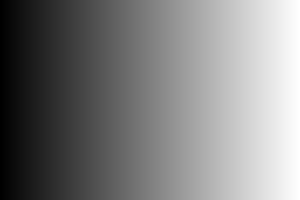     |

## Exercice 6 : Miroir

J’ai commencé par écrire : `x=image.width()-(x+1)` au lieu d’inverser les couleurs des pixels.
Ensuite j’ai parcouru tous les pixels de l’image sur la largeur au lieu de parcourir seulement la moitié.
Voici le résultat après avoir corrigé ces erreurs :

| Avant      |    Après     |
| ------------- | :-----------: | 
| |      |

## Exercice 7 : Image bruitée

Au début j'ai écrit cela :
```cpp
void noise(sil::Image& image)
{
    for (int i {0} ; i<(10000) ; i++)
    {
        int X {random_int(0,image.width()-1)} ; //attention les colonnes vont de 0 à 299 (si width=300)
        int Y {random_int(0,image.height()-1)} ;
        for (glm::vec3& color : image.pixels())
        {
            image.pixel(X,Y) = glm::vec3{random_float(0,1), random_float(0,1), random_float(0,1)};
        } 
    }    
}
```
avant de me rendre compte de mes erreurs. En effet, ma deuxième boucle `for` n'est pas utile donc je l'ai supprimmée et j'ai remplacée `1000` par la formule `image.width()*image.height()/10` (j'ai choisi de diviser par 10 mais ça aurait pu être un autre nombre).

| Avant      |    Après     |
| ------------- | :-----------: | 
| |      |

## Exercice 8 : Rotation de 90°

Je pensais d’abord qu’il suffisait d’inverser les lignes et les colonnes de mon image pour qu’elle effectue un angle de 90° mais ça ne fonctionnait évidemment pas. C’est en essayant sur papier que j’ai compris que la nouvelle ligne de mon image était égale au nombre de colonne de l’ancienne auquel on retire le numéro de colonne du pixel et 1 car les colonnes et lignes commencent à 0 en CPP.
De plus, dans cet exercice on ne modifie pas l’image d’origine (d’où le `const&` qui nous empêche de la modifier), on en créer une nouvelle (les dimensions changent si notre image n’est pas carrée) donc je n’ai pas utilisé la fonction `void` comme dans la plupart des exercices précédents.

| Avant      |    Après     |
| ------------- | :-----------: | 
| |      |


## Exercice 9 : RGB split

Pour gérer les bords j’ai d’abord mis une condition afin que les pixels sur la longueur trop proches du bord gardent leur couleur originale :
```cpp
if (x<30 || (image.width()-30)<=x)
            {
                RGB.pixel(x, y) = image.pixel(x, y) ;
            }
```
Mais alors je n’obtenais pas exactement le résultat voulu. 
**Raté n°1 :**

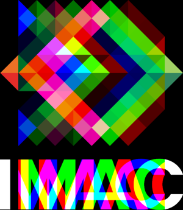

**Raté n°2 :**

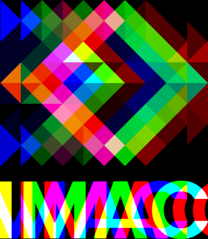

| Avant      |    Après     |
| ------------- | :-----------: | 
| |      |

## Exercice 10 : Luminosité

1er essai : J’ai utilisé la fonction puissance (avec `pow( , )`). En choisissant a=2,5 comme exposant de `color.r`, `color.b` et `color.g` j’ai obtenu l’image suivante :

| Avant      |    Après     |
| ------------- | :-----------: | 
| | 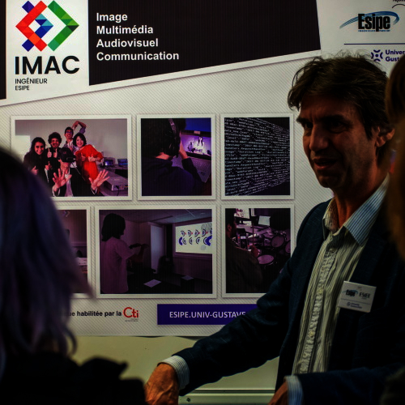     |

Avec a=0,5 comme exposant j’obtiens l’image éclaircie :

| Avant      |    Après     |
| ------------- | :-----------: | 
| |      |

## Exercice 11 : Disque

Pour cette exercice, il faut d'abord créer une image noire puis y ajouter notre disque blanc.
1er essai :
```cpp
int milieu{image.width()/2} ;
    int rayon {100} ;
    for (int x{milieu-rayon}; x <= 2*rayon ; x++)
    {
        for (int y{milieu-rayon}; y <= 2*rayon; y++)
        {
            cercle.pixel(x, y).r = 1.f;
            cercle.pixel(x, y).g = 1.f;
            cercle.pixel(x, y).b = 1.f;
        }
    }
```
donnant : 

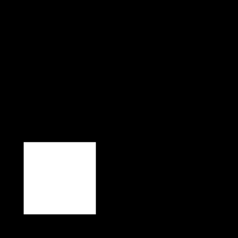

2e essai : J’ai utilisé l’équation d’un cercle :
```cpp
int milieu {500/2} ;
    int rayon {100} ;
    for (int x{milieu-rayon}; x <= 2*rayon ; x++)
    {
        for (int y{milieu-rayon}; y <= 2*rayon; y++)
        {
            if ((pow((x-milieu),2)+pow(y-milieu,2))<pow(rayon,2))
            {
                rond.pixel(x, y).r = 1.f;
                rond.pixel(x, y).g = 1.f;
                rond.pixel(x, y).b = 1.f;
            }
        }
    }   
    return rond ;
```
Ce qui m'a donné :

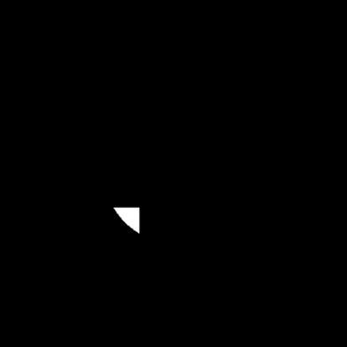

En me relisant, j’ai rapidement vu que le problème était la limite de x et y que j’avais posée à `2*rayon` au lieu de `milieu + rayon`. Avec cette correction faite j’ai obtenu l’image suivante :


## Exercice 12 : Cercle

Pour cet effet, j'ai d'abord pensé qu'il fallait ajouté au disque blanc fait dans l’exercice précédent un disque noir d’un rayon plus petit. 
Finalement, j'ai compris que je pouvais colorer les pixels à l'intérieur d'un cercle mais également à l'extérieur.
Ainsi, j'ai compris qu'il fallait colorer en blanc les pixels qui sont à la fois à l'intérieur du cercle de rayon `rayon+10` et à l'extérieur du cercle de rayon `rayon`.

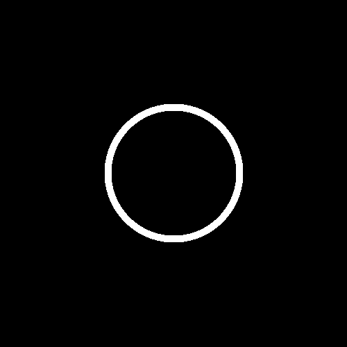


## Autre effet :

En voulant créer une animation avec mon disque blanc j'ai crée un autre effet assez sympa par erreur en écrivant :
```cpp
sil::Image animation(sil::Image const& image) 
{
    sil::Image anime{500, 500};
    int milieu {500/2} ;
    int rayon {100} ;
    for (int i {0} ; i<140 ; i++)
    {
        for (int x{0}; x <= anime.width() ; x+=5)
    {
        for (int y{0}; y <= anime.height(); y+=5)
        {
            if ((pow((x-milieu),2)+pow(y-milieu,2))<pow(rayon,2))
            {
                anime.pixel(x, y).r = 1.f;
                anime.pixel(x, y).g = 1.f;
                anime.pixel(x, y).b = 1.f;
            }
        }
    }   
    }
    return anime ;
}
```
Cela est dû aux 2e et 3e boucles `for` et le pas de 5.

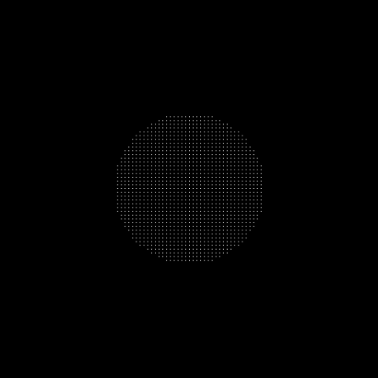

## Exercice 13 : Animation 

J'ai d'abord essayé d'obtenir un disque blanc décalé sur la gauche plutôt que centré pour trouver quel morceau de mon code je devais modifier pour pouvoir déplacer le disque horizontalement pour l'animation. J'ai alors fixé le centre à `100` plutôt que la moitié de mon image afin de bien voir le décalage. J'ai donc écrit :
```cpp
sil::Image animation(sil::Image const& image) 
{
    sil::Image anime{500, 500};
    int milieu {100} ;
    int rayon {100} ;
    for (int x{milieu-rayon}; x <= milieu+rayon ; x++)
    {
        for (int y{milieu-rayon}; y <= milieu+rayon; y++)
        {
            if ((pow((x-milieu),2)+pow(y-milieu,2))<pow(rayon,2))
            {
                anime.pixel(x, y).r = 1.f;
                anime.pixel(x, y).g = 1.f;
                anime.pixel(x, y).b = 1.f;
            }
        }
    }   
    return anime ;
}
```
Mais j'ai obtenu :

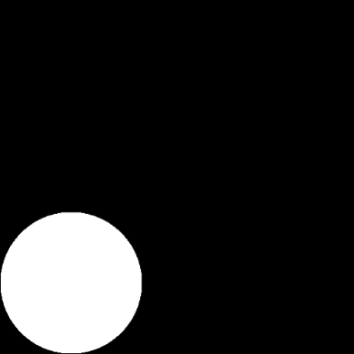

car je n'avais pas pensé au fait que le centre vertical reste le même, `y` ne varie pas, seulement `x`.
J'ai donc corrigé cela en remplaçant la première ligne de ma seconde boucle`for` (`for (int y{milieu-rayon}; y <= milieu+rayon; y++)`) par :

`for (int y{anime.height()/2-rayon}; y <= milieu+rayon; y++)`

(où `anime` est mon image).

Seulement, il restait un erreur dans mon code puisque j'ai obtenu l'image suivante :

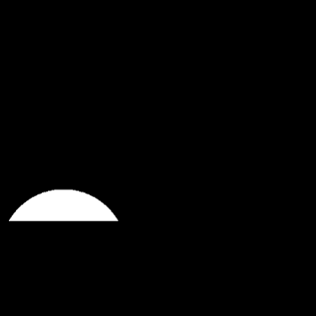

En effet, j'avais oublié de changer le centre de l'axe des ordonnées sur la ligne du `if` donc le disque se construisait autour du mauvais centre. 

Après correction de cette dernière erreur j'ai peu créer plusieurs images de mon disque à différentes positions sur l'axe des abscisses. J'ai généré 60 images avec le disque qui se déplaces de 5 pixels à chaque chnagement de position, obtenant ainsi l'animation suivante :

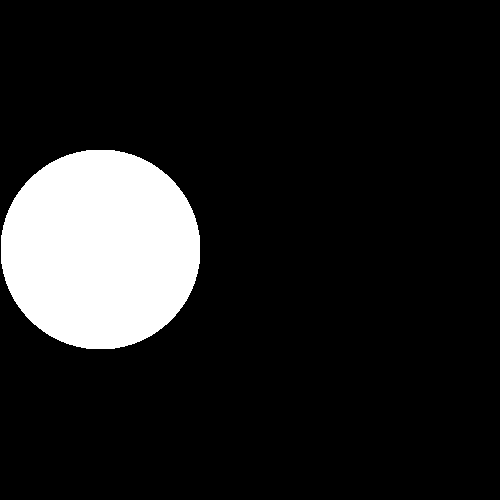

## Exercice 14 : Mosaïque

Mon idée de départ était de diviser les dimensions de mon image de départ par 5 pour les dimensions des plus petites images mais finalement c'est plus pratique de multiplier l'image d'origine par 5.
Il fallait alors parcourir les pixels de l'image 5 fois, d'où les boucles `for` avec les variables i et j puis utiliser un modulo pour avoir les pixels de notre nouvelle image réduis 5 fois.

| Avant      |    Après     |
| ------------- | :-----------: | 
| | 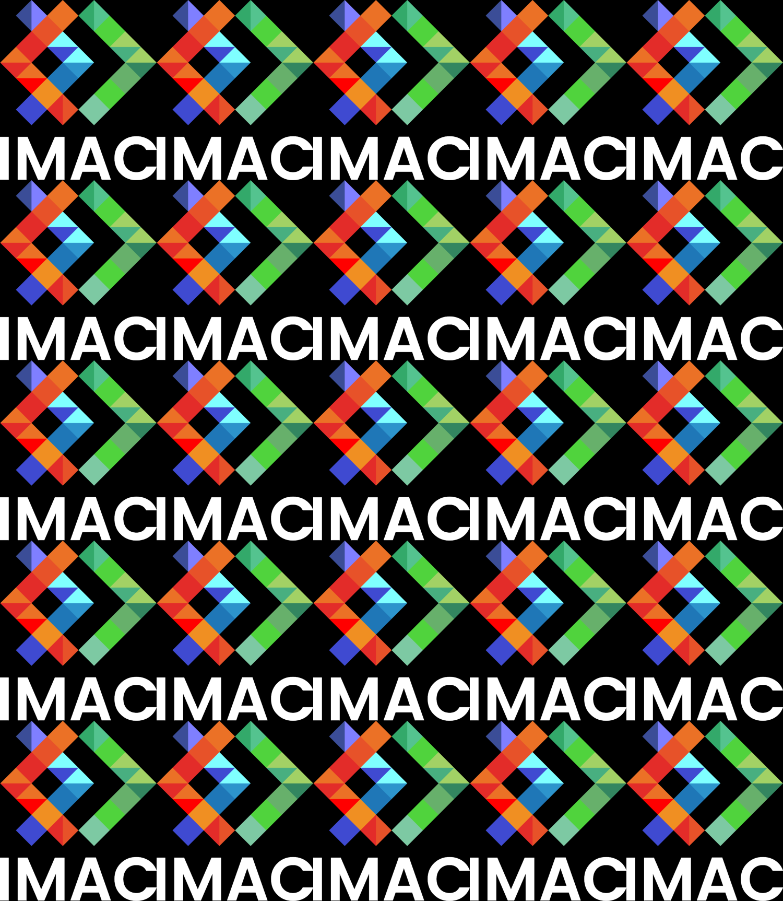     |


## Exercice 15 : Mosaïque miroir

La première étape fut d'écrire 2 fonctions qui retournent en miroir une image horizontalement et verticalement. Une fonction pour le miroir vertical et la 2e pour le miroir horizontal. J'ai repris le modèle de la fonction `miroir` définie plus haut.
Au départ je voulais retourner les petites images en fonction de leur position, c'est-à-dire retourner les petites images dont l'abscisse est entre 100 et 200 pixels et entre 300 et 400 pixels si les dimensions de l'image d'origine sont 500x500.
Finalement, je me suis rendue compte qu'utiliser un modulo était plus simple et plus judicieux.
De plus, je me suis rendue compte que les deux fonctions `miroir` n'étaient finalement pas utiles, j'ai réécrit leur contenu directement dans ma fonction `mosa_miroir`.
Puis, après avoir remarqué qu'il y avait 4 images différentes qui se répetent, j'ai fait une disjonction de cas en utilisant un modulo pour tester la parité de mes variables i et j.
La dernière chose que j'avais oublié et que je ne voyais pas c'est qu'il fallait augmenter x de `image.width()*i` et y de `image.height()*j` pour prendre les pixels de la bonne petite image.
| Avant      |    Après     |
| ------------- | :-----------: | 
| | 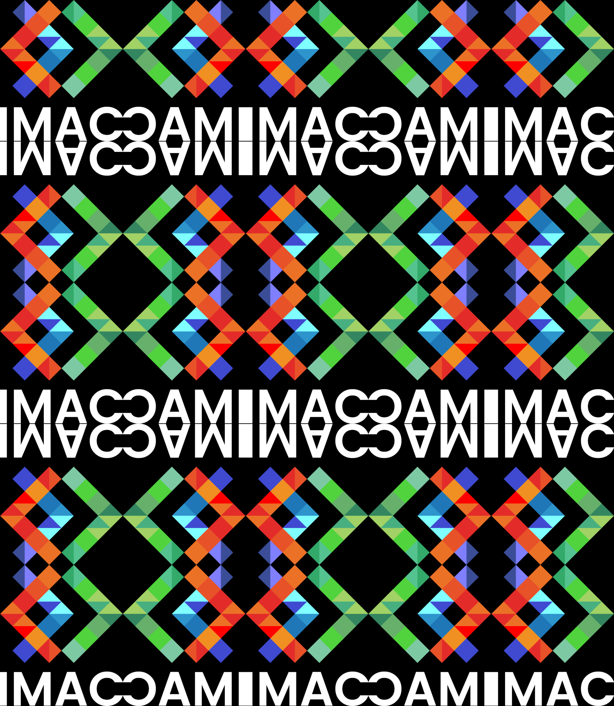     |

## Exercice 16 : Glitch 

J'ai rapidement compris qu'il fallait partir d'un pixel aléatoire, prendre ceux qui sont autour puis échanger ce rectangle avec un autre dans l'image, puis répéter cela un certain nombre de fois (j'ai choisi de le faire 100 fois).

| Avant      |    Après     |
| ------------- | :-----------: | 
| |      |